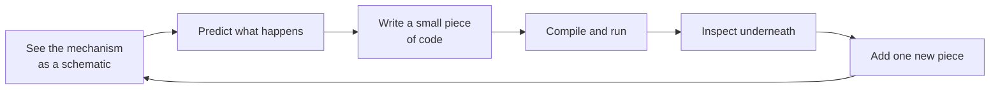
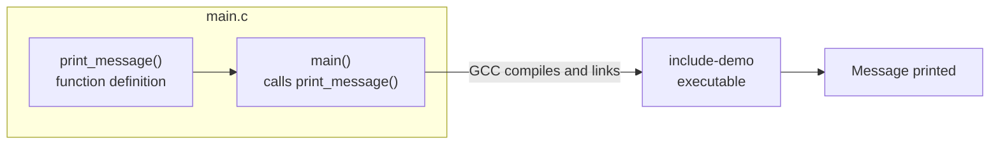

## This document exists to save schematics and short examples with explanations for my learning journey in C.

### Step 1: everything in one file

Create main.c in the lab directory. It should:
- include stdio.h;
- define void `print_message(void);`
- have that function print any short message you choose;
- define main;
- call `print_message` from main;
- return 0.

The next step will be to split this exercise into three separate files:
 - main.c      → uses the function
 - message.h   → declares the function
 - message.c   → defines the function
